<div align="center">

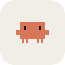

# Claude Mascot

**A pixel desktop pet for Claude Code on Windows.**<br>
The orange mascot from the Claude Code banner lives on your screen and shows what Claude is doing.

[](https://github.com/mayrwos/Claude-mascot/actions/workflows/build.yml)


[](LICENSE)

[**Download for Windows**](https://github.com/mayrwos/Claude-mascot/releases/latest) · [Video of every animation](docs/animations.mp4) · [Русский](README.ru.md)

</div>

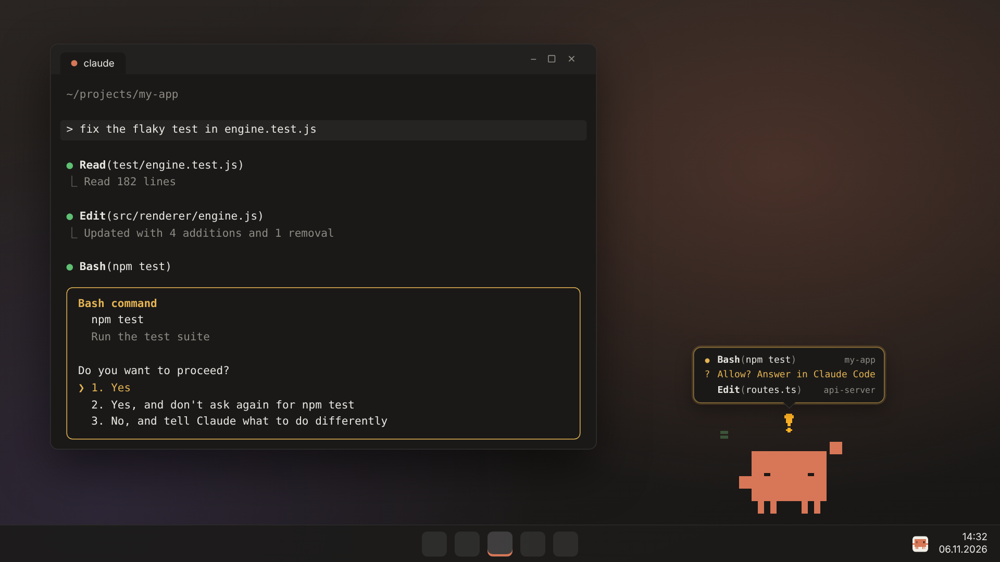

Claude Code works in the background while you do something else. Then it stops to ask for permission, and the session sits there until you happen to look. The mascot makes that impossible to miss: it thinks when Claude thinks, types on a laptop while Claude edits files, hops and waves when Claude needs you, and throws confetti when the turn is done.

It is made for Windows first, weighs a few megabytes (native Rust with Tauri), never steals focus, and lets every click outside its own pixels through to the window below.

## Meet the mascot

<table>
  <tr>
    <td align="center">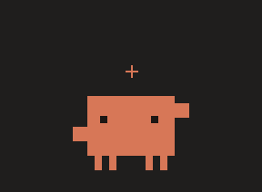<br><b>Thinking</b><br><sub>a prompt was sent</sub></td>
    <td align="center">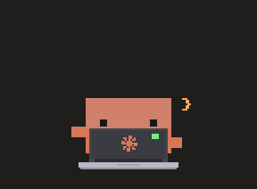<br><b>Writing code</b><br><sub>Claude runs tools</sub></td>
    <td align="center">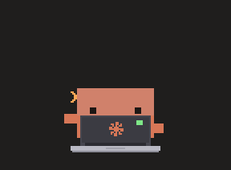<br><b>Helpers</b><br><sub>one per sub-agent</sub></td>
  </tr>
  <tr>
    <td align="center">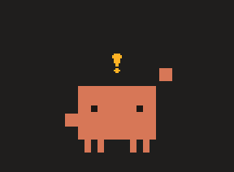<br><b>Needs you</b><br><sub>a permission prompt is waiting</sub></td>
    <td align="center">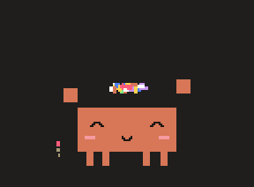<br><b>Done!</b><br><sub>the turn is finished</sub></td>
    <td align="center">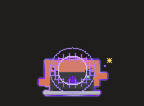<br><b>UltraCode</b><br><sub><code>ultrathink</code> in the prompt</sub></td>
  </tr>
  <tr>
    <td align="center">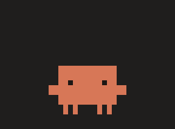<br><b>Oops</b><br><sub>a tool failed</sub></td>
    <td align="center"><br><b>Hearts</b><br><sub>click it, or click a lot</sub></td>
    <td align="center"><br><b>Jump</b><br><sub>double-click</sub></td>
  </tr>
  <tr>
    <td align="center">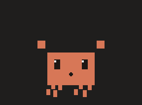<br><b>Pick it up</b><br><sub>the legs swing as you drag</sub></td>
    <td align="center">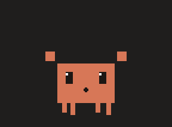<br><b>Throw it</b><br><sub>it flies, bounces and lands</sub></td>
    <td align="center">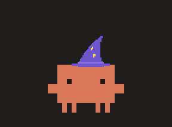<br><b>Hats</b><br><sub>five of them, Santa for the holidays</sub></td>
  </tr>
  <tr>
    <td align="center">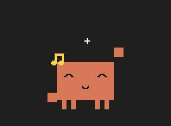<br><b>Dance</b><br><sub>when it feels like it</sub></td>
    <td align="center">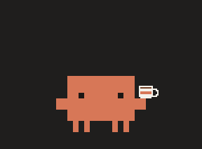<br><b>Coffee break</b><br><sub>when nothing is going on</sub></td>
    <td align="center">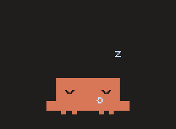<br><b>Nap</b><br><sub>after a while alone</sub></td>
  </tr>
</table>

## A whole session

<table>
  <tr>
    <td width="340" valign="top">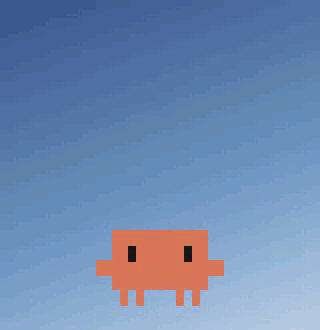</td>
    <td valign="top">

The status bubble looks like the Claude Code terminal: dark, monospace, the spinning `✻`, a shimmering verb and a timer.

| Claude Code | The mascot |
| --- | --- |
| got a prompt | `✻ Pondering… (12s)` and a spinner over its head |
| runs a tool | `● Edit(main.js)` at the laptop, code symbols fly |
| starts sub-agents | helpers walk in: Explore with a magnifier, Plan with a clipboard |
| waits for you | hops, waves, `!`, the bubble glows amber |
| finished | confetti and fireworks, `✻ Worked for 34s` |
| failed | x-eyes and a drop of sweat |
| compacts the context | gets squished |
| `ultrathink` | violet aura, sunglasses, types twice as fast |

With several sessions open it lists each one with its project and puts the one that needs you on top.

  </td>
  </tr>
</table>

Every move goes through a spring layer, so nothing snaps from one pose to the next. The body wobbles like jelly after each squash, the arms and the hat lag behind and catch up, jumps crouch before and squash after:

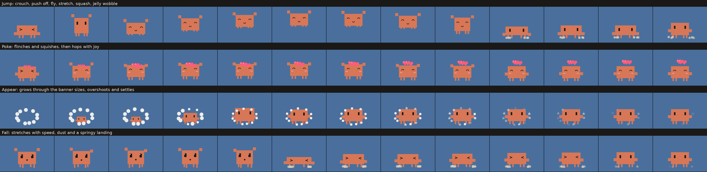

## Features

- **Two buttons on hover:** Open Claude (the desktop app, Claude Code in a terminal, or claude.ai) and Hide. Ctrl+Alt+M or the tray icon brings it back.
- **Hard to miss, easy to ignore:** always on top, never takes focus, clicks pass through everywhere except the mascot. It can pop back up by itself when Claude waits for you.
- **Many sessions at once,** each tracked on its own, plus a helper for every running sub-agent.
- **Lives its own life:** blinks, follows the cursor with its eyes, stretches, drinks coffee, dances, walks around if you let it, falls asleep when left alone (sooner at night).
- **Menu on right-click:** actions, UltraCode by hand, five hats, four sizes, gravity, wandering, 8-bit sounds, chatter, autostart with Windows, English or Russian.
- **Light on the machine:** a frame is drawn only when something changes, so it idles at almost zero CPU.

## Install

1. Download the `…_x64-setup.exe` installer, or the portable `.exe`, from [Releases](https://github.com/mayrwos/Claude-mascot/releases/latest). No admin rights needed.
2. Run it. On first start it offers to connect to Claude Code: say yes.
3. Start or restart Claude Code. That's all.

WebView2 is part of Windows 10 and 11; the installer fetches it if it is missing. The executables are not code-signed yet, so SmartScreen may warn on the first launch: **More info → Run anyway**.

<details>
<summary><b>Build from source</b></summary>

Needs [Rust](https://rustup.rs) and Node.js 20+.

```bash
npm ci
npm run dev        # run it
npm run build      # installers in src-tauri/target/release/bundle/
```

It also builds and runs on macOS and Linux, but Windows is the main target.

</details>

## How it connects to Claude Code

The mascot adds [HTTP hooks](https://code.claude.com/docs/en/hooks) to `~/.claude/settings.json` (or `$CLAUDE_CONFIG_DIR`). Claude Code then posts a short JSON message to the mascot on every event:

```json
{
  "hooks": {
    "PreToolUse": [
      { "matcher": "*", "hooks": [{ "type": "http", "url": "http://127.0.0.1:47821/hook?src=claude-mascot", "timeout": 3 }] }
    ]
  }
}
```

Events used: `SessionStart`, `SessionEnd`, `UserPromptSubmit`, `PreToolUse`, `PostToolUse`, `PostToolUseFailure`, `PermissionRequest`, `Notification`, `Stop`, `StopFailure`, `SubagentStart`, `SubagentStop`, `PreCompact`.

- Your own hooks stay as they are, and a backup `settings.json.mascot.bak` is written first. A file with broken JSON is not touched.
- **Disconnect (remove hooks)** in the menu removes exactly its own hooks, tagged `?src=claude-mascot`.
- It answers `200 OK` at once, so Claude Code never waits for it. If the mascot is not running, Claude Code just carries on.
- It works wherever Claude Code reads `~/.claude/settings.json`: any terminal, IDE extensions. The regular chat in the Claude app does not send hook events.

**Privacy.** Everything stays on your machine. The server listens on `127.0.0.1` only and rejects browser requests and foreign `Host` headers. Prompt text is never stored or sent anywhere: the mascot only checks it for the word `ultrathink`. From tool inputs it keeps a short label: a file name, the first words of a command, a domain.

## Script it

```powershell
# say something
curl.exe -X POST http://127.0.0.1:47821/say -H "Content-Type: application/json" -d "{\"text\":\"Build passed!\"}"

# play an animation: pet, jump, dance, coffee, wave, sleep, wake, celebrate, laptop, tip, say
curl.exe -X POST http://127.0.0.1:47821/action -H "Content-Type: application/json" -d "{\"name\":\"celebrate\"}"
```

Celebrate every green CI run, or every `git push`.

## Under the hood

```
src-tauri/      native side in Rust (Tauri 2)
  src/lib.rs      window, tray, menu, click-through, drag and throw, webview commands
  src/physics.rs  throws, gravity, bounces, dizziness
  src/geom.rs     monitors, bounds, hit testing
  src/server.rs   the hook server on 127.0.0.1
  src/hooks.rs    adds and removes the hooks in Claude Code's settings.json
  src/events.rs   turns hook payloads into short, display-safe events
src/renderer/   the mascot: pixel art (art.js), animation (engine.js), sessions (sessions.js), UI (app.js)
scripts/        icons and the pictures in this README
```

The mascot is drawn entirely in code with `fillRect` on a 160×120 grid, no image files. It keeps the proportions of the Claude Code banner and is flat like in the terminal: one orange `#D77757`, black eyes, no shading. Click-through is decided natively from rectangles the renderer sends, so a click next to the mascot goes straight to the window below.

## License

MIT, see [LICENSE](LICENSE).

Unofficial fan project. Not affiliated with or endorsed by Anthropic. Claude, Claude Code and the Claude mascot are trademarks of Anthropic, PBC.
