<div align="center">

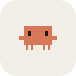

# Claude Mascot

**Пиксельный маскот для Claude Code на Windows.**<br>
Оранжевый Клод из приветствия Claude Code живёт на рабочем столе и показывает, чем сейчас занят Claude.

[](https://github.com/mayrwos/Claude-mascot/actions/workflows/build.yml)


[](LICENSE)

[**Скачать для Windows**](https://github.com/mayrwos/Claude-mascot/releases/latest) · [Видео всех анимаций](docs/animations.ru.mp4) · [English](README.md)

</div>

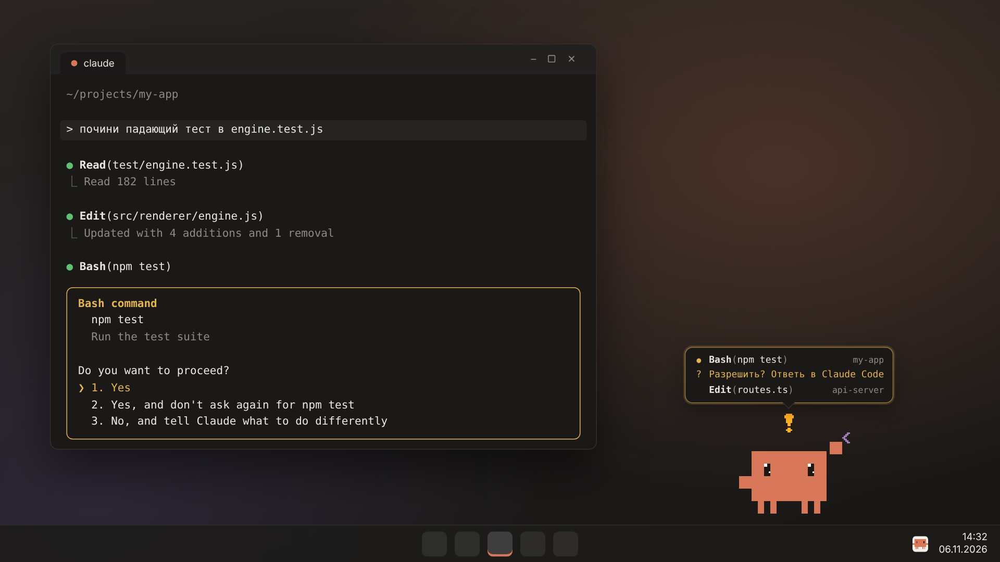

Claude Code работает в фоне, пока ты занят другим, а потом останавливается и ждёт разрешения, и сессия стоит, пока ты случайно не заглянешь. С маскотом это не пропустишь: он думает, когда думает Claude, печатает за ноутбуком, пока Claude правит файлы, прыгает и машет, когда нужен ты, и запускает салют, когда всё готово.

Сделан в первую очередь для Windows, весит несколько мегабайт (нативная часть на Rust, [Tauri 2](https://tauri.app)), не забирает фокус и пропускает клики мимо себя в окна под ним.

## Знакомьтесь

<table>
  <tr>
    <td align="center">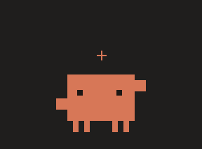<br><b>Думает</b><br><sub>получил запрос</sub></td>
    <td align="center">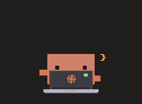<br><b>Пишет код</b><br><sub>Claude вызывает инструменты</sub></td>
    <td align="center">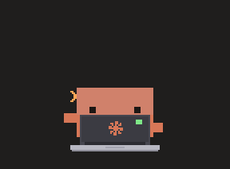<br><b>Помощники</b><br><sub>по одному на sub-агента</sub></td>
  </tr>
  <tr>
    <td align="center">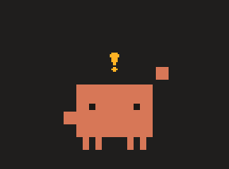<br><b>Зовёт тебя</b><br><sub>ждёт разрешения</sub></td>
    <td align="center">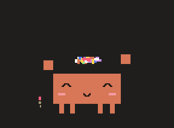<br><b>Готово!</b><br><sub>ход завершён</sub></td>
    <td align="center">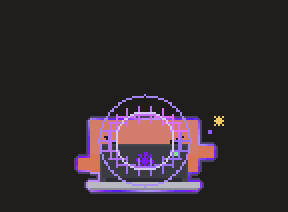<br><b>UltraCode</b><br><sub><code>ultrathink</code> в запросе</sub></td>
  </tr>
  <tr>
    <td align="center">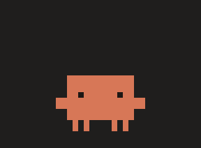<br><b>Ой</b><br><sub>инструмент упал</sub></td>
    <td align="center"><br><b>Сердечки</b><br><sub>кликни, а лучше много раз</sub></td>
    <td align="center"><br><b>Прыжок</b><br><sub>двойной клик</sub></td>
  </tr>
  <tr>
    <td align="center">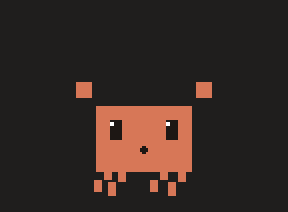<br><b>Взять в руки</b><br><sub>ноги болтаются, пока тащишь</sub></td>
    <td align="center">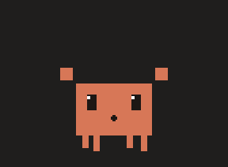<br><b>Бросить</b><br><sub>летит, отскакивает и приземляется</sub></td>
    <td align="center">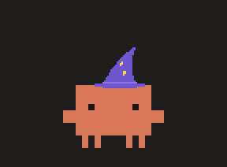<br><b>Шапки</b><br><sub>пять штук, на праздники Санта</sub></td>
  </tr>
  <tr>
    <td align="center">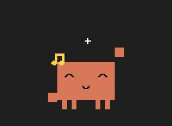<br><b>Танец</b><br><sub>когда захочется</sub></td>
    <td align="center">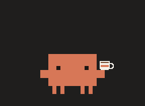<br><b>Кофе-брейк</b><br><sub>когда ничего не происходит</sub></td>
    <td align="center">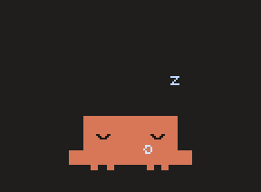<br><b>Сон</b><br><sub>если долго не трогать</sub></td>
  </tr>
</table>

## Целая сессия

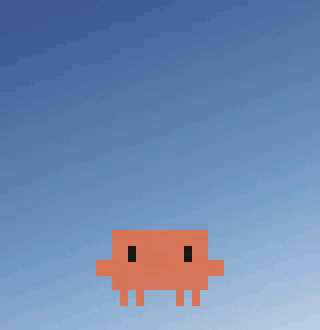

Пузырь сделан как статус-строка терминала Claude Code: тёмный фон, моноширинный шрифт, крутящийся `✻`, переливающийся текст и таймер. Если открыто несколько сессий, видны все, с названием проекта у каждой, а та, где нужен ты, стоит первой.

Ниже подробно, что он делает на каждое событие. А ещё каждое движение проходит через слой пружин, поэтому ничего не дёргается: тело желейно пружинит после каждого сжатия, руки и шапка отстают и догоняют, у прыжков есть присед до и приплющивание после.

<br clear="right">

## Что умеет

**Две кнопки.** Наведи курсор на маскота, и над ним появятся:

- **«Открыть Claude»** открывает приложение Claude. Если его нет, открывается claude.ai. В меню можно выбрать другое: Claude Code в терминале (Windows Terminal или cmd в выбранной папке) или claude.ai в браузере.
- **«Скрыть»** убирает маскота в трей, он исчезает в облачке дыма. Вернуть: клик по значку в трее или **Ctrl+Alt+M**.

**Реагирует на Claude Code** (после подключения, см. ниже):

| Что делает Claude | Что делает маскот |
| --- | --- |
| получил запрос | думает: смотрит вверх, над головой крутится ✻, иногда загорается лампочка-идея, в пузыре `✻ Колдую… (12s)` |
| вызывает инструменты | сидит за ноутбуком и печатает, иногда бьёт по Enter или задумывается, вокруг летят `</>` `{}` `;`, в пузыре `● Edit(main.js)` и `✻ Правлю… (8s)` |
| запустил сабагентов | мини-Клоды заходят из-за края, по одному на агента: у Explore лупа, у Plan планшет, остальные сидят за ноутбуками. Закончив, уходят обратно |
| ждёт разрешения | прыгает, машет, над головой «!», пузырь подсвечен (и звук «динь»). Если долго ждёт, руку в бок и стучит ногой |
| закончил | конфетти, фейерверки, прыжки, `✻ Готово за 34s` |
| ошибка инструмента | глаза-крестики, капля пота |
| сжимает контекст (`/compact`) | его сплющивает |
| в запросе есть `ultrathink` / `ultracode` | **UltraCode**: ударная волна, тёмные очки, фиолетовая аура и искры, печатает в два раза быстрее |

Пузырь сделан как статус-строка терминала Claude Code: тёмный фон, моноширинный шрифт, крутящийся `✻`, переливающийся текст и таймер. У края экрана пузырь и кнопки сдвигаются, чтобы не обрезаться, а хвостик всё равно указывает на маскота. Если открыто несколько сессий, в пузыре видны они все, с названием проекта у каждой. Тема только тёмная, меню тоже тёмные.

**Можно потрогать:**

- клик: сердечки и счастливые глаза ^‿^; 6 быстрых кликов: глаза-сердечки и «Я тоже тебя люблю!»
- двойной клик: прыжок
- перетаскивание: болтает ногами, которые отстают, если быстро тащить, и кричит «Уиии!». Если отпустить на лету, полетит дальше, приземлится с облачками пыли. Если сильно потрясти, закружится голова
- правый клик: меню со всем остальным

**Живёт своей жизнью:** моргает (иногда дважды), плавно переводит глаза за курсором, выглядывает в сторону, потягивается, пьёт кофе, танцует, гуляет с отмашкой рук. Иногда даёт советы по Claude Code. Если долго не трогать, зевает и засыпает: летят Zzz, а пузырь из носа надувается и лопается. Ночью засыпает быстрее. Если разбудить кликом, подскочит с «!?».

**Как он двигается.** Между позой и экраном стоит слой пружин, поэтому ничего не меняется рывком. Тело желейно пружинит после каждого сжатия, руки догоняют движение и чуть отстают от тела, шапка подпрыгивает сама по себе, ноги при раскачивании ходят маятником, ноутбук выезжает снизу. У прыжков есть присед перед толчком, вытягивание в полёте, приплющивание и отскок после приземления. Появляется Клод из дыма: растёт через размеры баннера, проскакивает дальше нужного и оседает.

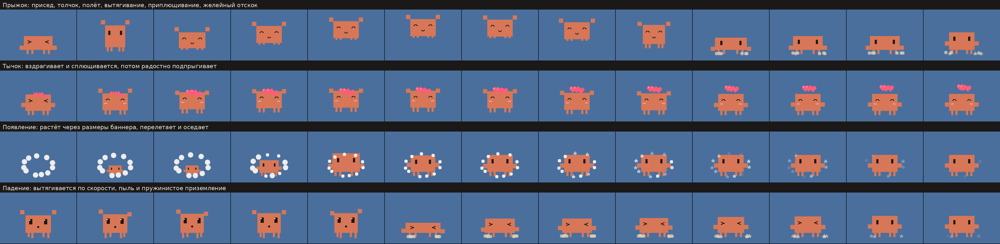

Все анимации подряд, с подписями: [docs/animations.ru.mp4](docs/animations.ru.mp4) (1 минута).

**Меню (правый клик или трей):**

- действия: погладить, прыгнуть, потанцевать, кофе-брейк, поработать за ноутом, поспать
- режим UltraCode, который можно включить вручную
- шапки: праздничный колпак, корона, шапка Санты, вязаная шапка, шляпа волшебника. В режиме «Авто» шапка Санты появляется сама с 10 декабря по 7 января
- размер: 4 варианта
- **гравитация**: маскот стоит на панели задач, его можно подбросить, он отскакивает от краёв экрана
- **прогулки**: сам ходит по экрану
- звуки (8-бит, синтезируются на лету), болтовня, поверх всех окон, «появляться, когда Claude ждёт ответа»
- автозапуск с Windows, язык (русский / English)

## Установка

### Готовый .exe

1. Скачай установщик `…_x64-setup.exe` (или portable `.exe`, его ставить не нужно) на странице [Releases](https://github.com/mayrwos/Claude-mascot/releases/latest). Ставится для текущего пользователя, права администратора не нужны.
2. Запусти. При первом запуске маскот предложит подключиться к Claude Code, соглашайся.
3. Запусти или перезапусти Claude Code. Всё.

Нужен WebView2: в Windows 10 и 11 он уже есть, а если нет, установщик скачает его сам.

> Exe-файлы пока не подписаны, поэтому Windows SmartScreen может предупредить при первом запуске: «Подробнее» → «Выполнить в любом случае».

### Из исходников

Нужны [Rust](https://rustup.rs) и Node.js 20+ (Node нужен только для CLI Tauri).

```bash
npm ci
npm run dev        # запустить
npm run build      # собрать установщики в src-tauri/target/release/bundle/
```

## Подключение к Claude Code

Правый клик по маскоту → **Интеграция с Claude Code** → **Подключить (добавить хуки)**. Потом перезапусти Claude Code или начни новую сессию.

Маскот добавит в `%USERPROFILE%\.claude\settings.json` (или в `$CLAUDE_CONFIG_DIR`) [HTTP-хуки](https://code.claude.com/docs/en/hooks) такого вида:

```json
{
  "hooks": {
    "PreToolUse": [
      { "matcher": "*", "hooks": [{ "type": "http", "url": "http://127.0.0.1:47821/hook?src=claude-mascot", "timeout": 3 }] }
    ],
    "Stop": [
      { "hooks": [{ "type": "http", "url": "http://127.0.0.1:47821/hook?src=claude-mascot", "timeout": 3 }] }
    ]
  }
}
```

Хуки ставятся на `SessionStart`, `SessionEnd`, `UserPromptSubmit`, `PreToolUse`, `PostToolUse`, `PostToolUseFailure`, `PermissionRequest`, `Notification`, `Stop`, `StopFailure`, `SubagentStart`, `SubagentStop` и `PreCompact`.

- Твои собственные хуки остаются как были. Перед записью делается копия `settings.json.mascot.bak`. Если в `settings.json` ошибка в JSON, маскот файл не трогает.
- Свои хуки маскот находит по метке `?src=claude-mascot`, так что **Отключить** удаляет ровно их.
- Маскот сразу отвечает пустым `200 OK`, поэтому Claude Code его не ждёт и ничего не блокируется.
- Если маскот не запущен, Claude Code продолжит работу: недоступный HTTP-хук для него неблокирующая ошибка. В подробном режиме может мелькнуть строка об ошибке хука. Совсем убрать хуки можно через «Отключить».
- Нужна свежая версия Claude Code с поддержкой хуков `"type": "http"`.
- Хуки читаются из `~/.claude/settings.json`, так что маскот должен работать везде, где Claude Code берёт настройки оттуда: в терминале, в IDE и, скорее всего, во вкладке Code приложения Claude.

Пункт меню **Демо: показать реакции на Claude** проигрывает сценарий целиком (думает → работает → сабагенты → ждёт → готово → UltraCode), Claude Code для этого не нужен.

### Приватность

Всё происходит на твоём компьютере: сервер слушает только `127.0.0.1`. Текст запросов не сохраняется и никуда не передаётся. Маскот только проверяет, есть ли в нём слово `ultrathink`. От аргументов инструментов остаётся короткая подпись: имя файла, первые слова команды, домен сайта. Запросы из браузера (с заголовками `Origin` / `Sec-Fetch-*`) и с чужим `Host` отклоняются.

## Управлять из своих скриптов

```powershell
# сказать что-нибудь
curl.exe -X POST http://127.0.0.1:47821/say -H "Content-Type: application/json" -d "{\"text\":\"Сборка прошла!\"}"

# анимация: pet, jump, dance, coffee, wave, sleep, wake, celebrate, laptop, tip, say
curl.exe -X POST http://127.0.0.1:47821/action -H "Content-Type: application/json" -d "{\"name\":\"celebrate\"}"

# проверить, что маскот запущен
curl.exe http://127.0.0.1:47821/health
```

Например, можно праздновать конфетти каждый успешный `git push`.

## Где лежат настройки

`%APPDATA%\dev.claude-mascot.app\settings.json`: положение на экране, размер, шапка, переключатели и счётчик поглаживаний.

## Для разработчиков

```
src-tauri/       нативная часть на Rust (Tauri 2)
  src/lib.rs       окно, трей, меню, click-through, перетаскивание, команды для webview
  src/physics.rs   броски, гравитация, «укачало»
  src/geom.rs      мониторы, границы, видимая часть окна, попадание по кликабельным областям
  src/server.rs    HTTP-сервер для хуков на 127.0.0.1
  src/hooks.rs     установка и удаление хуков в settings.json Claude Code
  src/events.rs    разбор событий хуков (в webview уходят только короткие подписи)
  src/settings.rs  настройки
src/renderer/    маскот: пиксель-арт (art.js), анимации (engine.js), сессии (sessions.js), UI (app.js)
src/shared/      общие константы раскладки и тексты (ru/en)
scripts/         иконки и картинки для README
```

Весь маскот нарисован кодом: на сетке 160×120 клеток вызывается `fillRect`, картинок нет. Пропорции взяты из баннера Claude Code (тело 12×8 «символов», глаза, руки, четыре ноги). Как и в консоли, он плоский: один оранжевый `#D77757`, чёрные глаза, никаких теней. Детали появляются в мимике, позах, шапках и предметах. Эти же функции рисуют иконки приложения.

Кадр перерисовывается, только когда что-то изменилось: в покое маскот почти не тратит процессор. Где можно кликнуть, решает нативная часть по прямоугольникам, которые присылает рендерер, без лишних обращений к webview. Поэтому клик сразу после наведения попадает в маскота, а мимо него проходит в окно под ним.

## Лицензия

MIT, см. [LICENSE](LICENSE).

Неофициальный фанатский проект. Не связан с Anthropic и не одобрен ею. Claude, Claude Code и маскот Claude являются товарными знаками Anthropic, PBC.
